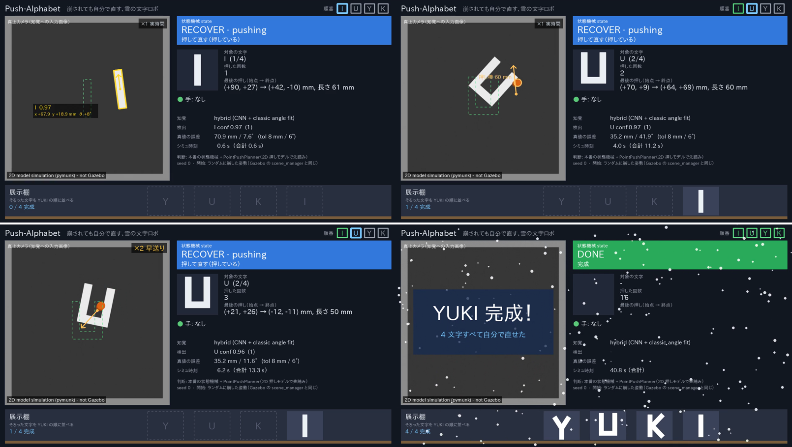
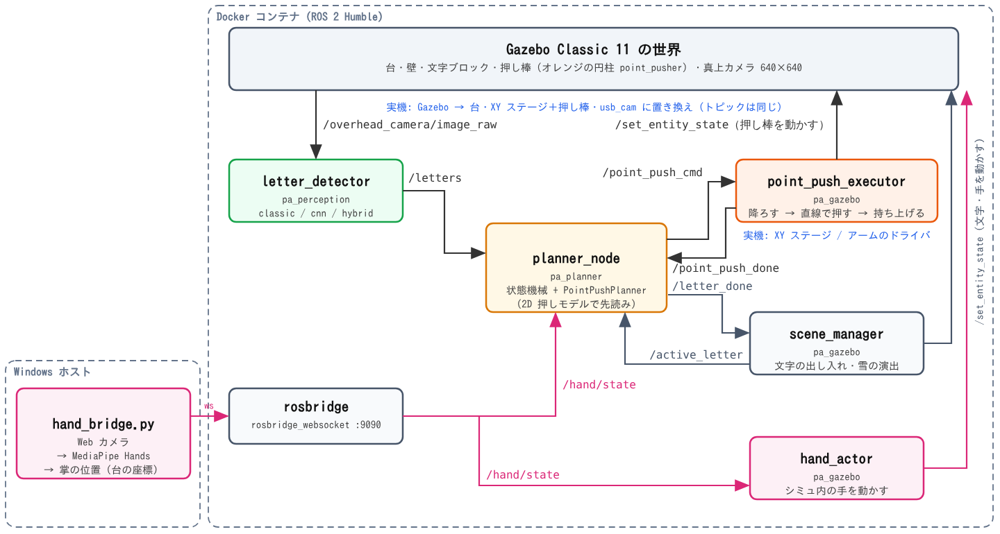

## 1. 概要と目的

**Push-T を机上の「文字並べ」に拡張した課題です。** Push-T は、T 字のブロックを点で押して目標の位置と向きにそろえる操作課題です。本課題では、20 cm 角ほどの台の上に置いた文字ブロック（Y・U・K・I）を真上のカメラで見て、Push-T と同じ **点の押し棒**（細い円柱。降ろして直線で押し、持ち上げる）で押し、目標の位置・向きにそろえます。

当初は台の四辺に置いた 4 本の回転ヘラ（サーボ相当）で押していましたが、**ヘラでは U を確実に回せませんでした**（2D モデルで teleport の崩しから 13/20、Gazebo では I は直せたが U は 30 回押しても直せなかった。5.3 節）。そこで最終版では押し棒に切り替えました（2.1 節）。ヘラ版のコードも残してあり、設定 `pusher_mode` で切り替えられます。

さらに **「人の手で崩されても、自分で直す」** ことを目標にしました。PC の Web カメラで自分の手を検出し、シミュレーション内の「手」で文字を払って崩します。ロボットは手がある間は待ち、手が離れると押して直し始めます。I → U → Y → K の順に 1 文字ずつ直し、そろった文字は展示棚へ移して YUKI の順に並べ、4 文字そろうと雪が降ります（図 1）。

- AI は推論で 2 か所に使っています。(1) 真上カメラ画像から文字の種類と姿勢を推定する CNN、(2) Web カメラ画像から手を検出する MediaPipe Hands です（3 章）。
- 後で実機（XY ステージまたはアームの先に押し棒のピンを付けたもの）に移すことを前提に、ノード構成とトピックを実機と共通にしました（2 章）。

{width=94%}

## 2. システム構成

ROS 2 Humble と Gazebo Classic 11 を Docker コンテナ（講義のイメージ＋追加パッケージ）で動かし、手の検出だけを Web カメラのつながったホスト PC で動かします。ノードとトピックの構成を図 2 に示します。

{width=100%}

| トピック | 出す側 → 受ける側 | 内容 |
|--------------------------|----------------------------------|----------------------------|
| `/overhead_camera/image_raw` | Gazebo（実機は usb_cam）→ letter_detector | 真上カメラ 640×640 |
| `/letters` | letter_detector → planner_node | 見えている文字の種類と姿勢 (x, y, θ, 確信度) |
| `/point_push_cmd`, `/point_push_done` | planner_node ⇄ point_push_executor（実機は XY ステージのドライバ） | 押しの始点と終点 (x0, y0) → (x1, y1)、速さ / 押し終えて待機位置に戻った |
| `/hand/state` | hand_bridge（rosbridge 経由）→ hand_actor, planner_node | 手の有無と掌の位置（台の座標） |
| `/active_letter`, `/letter_done` | scene_manager ⇄ planner_node | いま直す文字 / そろった |

### 2.1 押し棒（Push-T 型）

- **押し棒**: 半径 6 mm・長さ 3 cm の円柱です。待機位置（台の角の上空）から押しの始点の上へ移動 → 台から 1 mm まで降ろす → 5 cm/s で直線に押す（1 回 6 cm まで）→ 持ち上げる → 待機位置に戻る、を 1 回の押しとします。Gazebo では `point_push_executor` が押し棒のモデル（オレンジ）をシミュレーション時間に合わせて動かします。オレンジは知覚では「隠すもの」として扱う色なので、文字と取り違えません。
- **ヘラから切り替えた理由**: ヘラは回転軸が台の辺に固定されているため、押せる場所と向きが限られます。特に U は、台の中央付近で 30〜90° 傾くと 2 本のヘラで押し戻し合う往復になり、回しきれませんでした（2D モデルの teleport で 13/20、hybrid 知覚で 8/20）。Gazebo では、ヘラ版で I は直せましたが、U は 30 回押しても直せず、知覚した U の輪郭が実際の U と合わない場面も多く見られました。押し棒なら文字のどの辺のどこでも、どの向きにも押せるので、腕の端を押して回す動きが 1〜2 手でできます。
- **寸法の一元化**: 台・押し棒（とヘラ）・文字の形・カメラ・目標姿勢と許容値（8 mm・6°）はすべて `scene.yaml` 1 か所に書き、Gazebo のモデル生成（URDF・SDF）、2D 押しモデル、知覚の合成画像が同じ値を読みます。
- **予測プランナー**: `planner_node` の中で、Push-T と同じ考え方の 2D 押しモデル（物理エンジン pymunk）を使い、文字の辺から作った押し方の候補を先読みして、目標に一番近づく押し方を選びます（4.3 節）。
- **実機と共通のインターフェース**: 指令は `PointPushCommand(x0, y0, x1, y1, speed)`（台の座標で始点と終点）だけで、XY ステージやアームの直線移動にそのまま対応します。実機では Gazebo を「台・XY ステージ＋押し棒・usb_cam」に、`point_push_executor` を XY ステージのドライバに置き換えるだけで、知覚・判断・手検出は流用できます。

## 3. AI の使い方

### 3.1 CNN による文字の種類・姿勢の推定（AI 1）

1. 画像を色で分けて、文字 1 個ずつのかたまりを取ります（4.1 節）。
2. かたまりの重心を中心に 192×192 px を切り出し、96×96 に縮小して小型 CNN（約 36 万パラメータ、ONNX で 1.4 MB）に入れます。
3. CNN は **文字の種類（I/U/Y/K）・向き（cos, sin）・中心のずれ** を同時に出します。向きは文字の対称性を考え、180° 対称な I では角度を 2 倍した値を学習させています。
4. 推論はコンテナの CPU 上の onnxruntime で行います。

**hybrid 方式**: CNN の向きの誤差（95% 点で 4.16°）は、目標の許容値 6° に対して余裕が少ないため、CNN の出力を初期値にして、文字の輪郭と形状モデルの重なり（IoU）が最大になるように向きを微調整する古典的な処理を後段に付けました。これで角度誤差の 95% 点は 0.46° になりました（5.1 節）。画像処理だけの方式（classic）も残し、パラメータ `method` で切り替えられます。

### 3.2 合成データの自動生成と学習

学習データは人手でラベル付けせず、`scene.yaml` の形とカメラの値から **真値付きの画像を自動生成** しました（`tools/gen_dataset.py`）。明るさ・ぼけ・照明のむら・ヘラや手などオレンジ・肌色の物体による遮蔽などをランダムに変え（ドメインランダム化）、学習用 6000 枚・検証用 1000 枚（乱数の seed を分ける）を作って学習しました（14 エポック、`tools/train_cnn.py`）。今回の CNN は合成画像だけで学習しており、Gazebo の画像は使っていません。

### 3.3 MediaPipe Hands による手の検出（AI 2）

ホスト PC で Web カメラ画像から MediaPipe Hands で手の骨格を検出し、掌の中心を台の座標に写して、rosbridge 経由で `/hand/state` に送ります（`host/hand_bridge.py`）。`hand_actor` がシミュレーション内の手のモデル（手のひら＋指の箱）を動かし、文字を物理的に払います。プランナーも同じトピックを見て、手がある間は押しません。プライバシーのため、カメラは机の上の手元だけを映し、映像は保存せずメモリ上で処理するだけにしました。プレビューも既定で黒背景に骨格だけを描きます。

## 4. 工夫した点

### 4.1 色による分割と、遮蔽に強い照合

最初の版では、文字に重なったヘラ（オレンジ。押し棒も同じ色）や手が文字と一体のかたまりになり、検出に失敗していました。取りこぼしの原因を自動で分類するツール（`tools/analyze_misses.py`）で調べると、**最大の原因は「ヘラ・手とのかたまりの結合」** でした。そこで次のように改善しました。

- 明るく彩度の低い画素だけを文字の候補とし、彩度の高い物体（ヘラ・押し棒・手）は「遮蔽物マスク」として分ける。
- 形の照合（IoU）では、遮蔽物の下の画素を「見えていない」として計算から外す。
- くっついた 2 文字を分割する処理と、背景モデルを加える。

強く隠れた文字も含む 1644 個での検出率は 69〜75% から 96〜97% に、誤検出は 20〜27 個から 0〜1 個に、U を I と読み違える誤りは 48〜56 個から 1〜3 個に減りました（合成画像での評価、3 方式の範囲）。

### 4.2 手がある間は待つ状態機械

状態機械（`pa_planner`）は「WAIT_LETTER → IDLE（見守り）→ WAIT_HAND（崩れを検知し、手が消えるのを待つ）→ RECOVER（撮る → 選ぶ → 押す → 静止を待つ を繰り返す）→ 次の文字 → DONE」と進みます。崩れの判定は目標から 15 mm または 12° 以上で、手が消えてから 1.0 s 待って押し始めます。復帰の途中で手が戻ってきたら WAIT_HAND に戻って一時停止します。30 回押してもそろわない場合は FAILED になり、人の手を待ちます。また、知覚の誤差で「真値ではわずかに外れているのにそろったと判断する」誤完了を防ぐため、「そろった」の判定は許容値の 0.8 倍以内（6.4 mm・4.8°）で行います。

### 4.3 押し棒のプランナー（候補の作り方・先読み・ずれへの強さ）

`PointPushPlanner`（`pa_core/pointplanner.py`）は、押し棒の 1 回の押し（始点 → 終点の直線）を次のように選びます。

- **文字の辺から候補を作る**: 文字は長方形の和で表しているので、外形にあたる各辺の上に 1〜3 点（辺の長さに応じて）の接触点を取ります。各点から、辺の内向きの法線と ±30° の 3 方向に押す候補を作り、押し棒は接触の 1 cm 手前に降ろします（文字の上に降りてしまう始点は捨てる）。押す深さは 1・2・4・最大 cm の数通りで、同じ始点・向きの深さ違いは 1 回のシミュレーションでまとめて計算します。始点か終点が台の外に出る候補も捨てます。
- **先読み**: 各候補を 2D 押しモデル（`PointPushSim`。ヘラ版と同じ床の摩擦・外周の壁）で計算し、目標からのずれ（位置・角度）と端への近さで評価します。上位 4 候補はもう 1 手先まで読み（粗い候補で）、2 手の組で良くなるものを選びます。目標の近く（2 cm・20° 以内）では 3・6 mm の細かい押しも加えます。
- **ずれへの強さ**: 1 手目の上位 8 候補は、姿勢を ±0.5 mm・±1° ずらして計算し直し、最悪の結果をその候補の評価にします。文字を弾き飛ばすような、初期値に敏感な押しを避けるためです。行き詰まったときは、良い候補の中から確率的に選び直します。
- **2D モデルの修正（ヘラ版で行ったもの）**: 2D 押しモデルが「同じ姿勢・同じ押しでも、直前に何を計算したかで結果が数 cm 変わる」履歴依存のバグを持っていたので、予測のたびに物理世界を作り直すように直し、Gazebo と同じ位置に外周の壁も入れました。押し棒のモデルもこの世界を共有します。
- 1 回の計画は平均 0.09〜0.21 s（文字による）で、ヘラ版（0.34〜0.56 s）より短くなりました。

### 4.4 評価ツールと再現性

- `tools/eval_perception.py`（知覚の比較）、`tools/analyze_misses.py`（取りこぼしの原因分類）、`tools/eval_recovery.py`（崩し → 復帰の成功率）を作り、改善のたびに同じ条件で数字を取りました。成功は知覚の出力ではなく **真値の姿勢で** 判定しています。
- `eval_recovery.py` は 2D モデルと Gazebo の 2 つのバックエンドを同じ形で持ち、判断には本番と同じ状態機械を使います。`--pusher point|paddles` で押し棒とヘラを同じ条件で比べられます（押し棒は 2D モデルのみ）。
- データ生成・評価はすべて **seed 固定** で、試行の乱数は (seed, 文字, 試行番号) から決まるため、並列数を変えても同じ結果になります。検出率の下限を確かめる回帰テスト（pytest）も用意しました。

## 5. 評価

**注意: 5.1・5.2 節の数値はすべて合成画像と 2D 押しモデル（pymunk）での評価で、Gazebo 上の数値ではありません。** 復帰の評価では、世界とプランナーの予測が同じ 2D モデルなので、モデル誤差（摩擦・接触・押す道具の動きの違い）は含まれていません。Gazebo や実機ではこれより下がると考えています。Gazebo での状況は 5.3 節に分けて書きます。

### 5.1 知覚の比較

合成画像の検証用 1000 枚のうち、遮蔽が 10% 以下の文字 1110 個での結果です（4.1 節の改善後）。

| 方式 | 検出率 | 適合率 | 位置誤差 95% | 角度誤差 95% | 1 フレーム |
|------------------------------|----------:|----------:|------------:|------------:|----------:|
| classic（画像処理のみ） | 99.7% | 99.9% | 0.61 mm | 0.90° | 28 ms |
| cnn | 99.7% | 100% | 0.90 mm | 4.16° | 19 ms |
| **hybrid（CNN ＋ 向きの微調整）** | 99.6% | 100% | 0.90 mm | **0.46°** | 30 ms |

検出率と位置では 3 方式に大きな差はなく、角度は hybrid が最も正確でした。遮蔽の強い文字も含む全 1644 個での検出率は classic 96.4%、cnn 96.8%、hybrid 96.6% です。合成画像では画像処理だけでも十分な精度が出ており、CNN の利点は、見た目の変わる実写への追加学習で発揮されると考えています。

### 5.2 崩し → 復帰の成功率（2D 押しモデル）：ヘラと押し棒の比較

各文字 20 回、目標の位置・向き（8 mm・6°）に 30 回以内の押しで戻せたら成功です。hand は手のモデルで払う崩し、teleport は作業領域内のランダムな姿勢に移す崩し（Gazebo の `scene_manager` と同じ）です。目標は I・U 90%、Y・K 70% としました。知覚は真値（知覚の代わりに真の姿勢を使う）で、押す道具だけを変えて比べました。

| 押す道具 / 崩し方 | I | U | Y | K | 計（seed 0） | 計（seed 1） | 平均押し回数（成功時） |
|--------------------------|------:|------:|------:|------:|----------:|----------:|---------------:|
| ヘラ / teleport | 20/20 | **13/20** | 20/20 | 15/20 | 68/80 | 72/80 | 8.4〜12.6 |
| ヘラ / hand | 20/20 | 19/20 | 20/20 | 17/20 | 76/80 | 75/80 | 7.0〜9.8 |
| **押し棒 / teleport** | **20/20** | **20/20** | **20/20** | **20/20** | **80/80** | **80/80** | **3.6〜4.1** |
| **押し棒 / hand** | **20/20** | **20/20** | **20/20** | **20/20** | **80/80** | **80/80** | **3.2〜3.6** |

（2D 押しモデルでの数値。文字ごとの欄は seed 0。平均押し回数は 2 seed の文字ごとの平均の範囲）

- **押し棒では、2 seed × 2 種類の崩し × 4 文字 × 20 回 = 320 試行がすべて成功しました**（ヘラは 291/320）。ヘラで最も苦手だった U の teleport も 40/40 です。押し回数はヘラの 1/2〜1/3（平均 3〜4 回、最大 7 回）、1 文字あたりのシミュレーション時間は平均 8〜10 s でした。
- **モデルのずれへの強さ**: 評価の世界だけ床の摩擦を 2 倍・0.4 倍、台の摩擦係数を 0.2・0.5 に変え、プランナーは元のモデルのまま予測させても、各文字 10/10 で成功しました。ただし、これは 2D モデルの中でのずれで、Gazebo との差（接触の扱い、知覚の誤差）は含みません。
- 画像の知覚（ヘラ版）: hybrid でも手で崩した場合は I・Y・K が目標に届き（I 19/20、U 18/20、Y 20/20、K 16/20）、真値との差は 0〜3 回でした。ヘラの teleport では角度推定の誤差で U の往復が増え、hybrid は U 8/20 まで下がりました。押し棒では提出動画の 2D デモ（hybrid 知覚、seed 0）で 4 文字すべてが 3〜5 回の押しでそろいました（成功率としては未測定）。
- **手がある間に押したことは 0 回** でした（ヘラ・押し棒とも）。手が去ってから押し始めるまでの待ちは毎回 1.00 s です。

### 5.3 Gazebo での状況

Gazebo の世界（台・壁・文字・手・真上カメラ、ヘラ版はヘラ、押し棒版は押し棒）、各ノード、Gazebo 用の評価バックエンド（`eval.launch.py` と `eval_recovery.py --backend gazebo`）を作成しました。

- **ヘラ版（Gazebo）**: I は、手で崩す → 手が離れて 1 s 待つ → 4 回押す → そろったと判定 → 展示棚へ、の一連の流れが Gazebo 上で動きました。U は 30 回押しても直せず FAILED になりました。このとき、知覚した U の輪郭が実際の U と合わない場面が多く見られました（合成画像だけで学習した知覚と、Gazebo の画像の見え方の差。6 章）。これが押し棒に切り替えた理由の一つです。
- **押し棒版（Gazebo）**: Gazebo 上で、崩れた位置に置かれた I・U・Y・K を順に押し棒で直し、4 文字とも目標姿勢にそろえて展示棚に YUKI と並べるところまで、一度の実行で最後まで動きました（4 文字で合計 25 回の押し、開始から約 2 分 30 秒、知覚は hybrid）。ヘラ版で直せなかった U も直せています。提出動画のロボットの部分は、この実行を真上カメラで録画したものです（U・Y・K の部分は 2 倍速）。ただし Gazebo での試行はこの 1 回で、成功率としては測れていません。

## 6. うまくいかなかった点と考察

- **ヘラでは U を回せなかった**: ヘラ版では、teleport で大きく向きを崩した U を真値でも 13/20 しか戻せず、台の中央付近で 30〜90° 傾いた U を 2 本のヘラで押し戻し合う往復になりました。プランナーの改善（頑健性チェック・端のコスト・3 手先読み）でも解けず、Gazebo でも U は 30 回押して直せませんでした（押し棒に変えたあとは Gazebo でも U を直せました）。また、ヘラの回転軸のすぐ近く（台の四隅）にある文字はどのヘラでも中央へ戻せない死角がありました。これらは押す道具の自由度の限界で、プランナーでは直せないと判断し、押し棒に切り替えました。押し棒では 2D モデル上で U も 40/40 で直せました。押し棒は台の上のどこにある文字にも横から近づけるので、ヘラの回転軸による死角もありません。
- **知覚の差（合成画像と Gazebo）**: Gazebo のヘラ版で、知覚した U の輪郭が実際の U と合わないことが多くありました。知覚の評価は合成画像だけで行っており、CNN も合成画像だけで学習しています。Gazebo の画像（光の当たり方、影、文字の側面の見え方）との差が、合成画像での高い精度（角度誤差 95% 点 0.46°）ほどには Gazebo で効かなかった原因と考えています。Gazebo の画像での追加学習と評価が必要です。
- **2D モデルの数値は上限に近い**: 復帰の評価は、世界とプランナーが同じ 2D モデルなので、モデル誤差を含まない上限に近い数字です。摩擦を変えた試験では押し棒は崩れませんでしたが、Gazebo では接触や押し棒の動き（降ろす高さ、速度）の違いで予測と実際がずれる押しが増えると考えています。頑健性チェックのずらし幅などは Gazebo で測って調整する必要があります。
- **Gazebo 上での検証が限られた点**: 時間の多くを 2D モデルでのプランナーと知覚の改善、押し棒への切り替えに使ったため、Gazebo 上での検証は限られました（5.3 節）。

## 7. 今後

- **実機**: XY ステージ（または小型のアーム）の先に押し棒のピンを付け、上下させる軸（またはピンを持ち上げる機構）を加えます。文字はスチレンボードで作ります。Gazebo を usb_cam に、`point_push_executor` を XY ステージのドライバ（始点へ移動 → 降ろす → 直線移動 → 持ち上げる）に置き換え、`/point_push_cmd` と知覚・判断・手検出はそのまま使います。ヘラ（SG90）の案は、U を回せない・四隅の死角があるため採りません。
- **CNN の追加学習と知覚の差の解消**: 合成画像で学習した CNN を、Gazebo の画像と実機のカメラで撮った画像で追加学習します。Gazebo で見られた「知覚した輪郭と実際の文字が合わない」問題を、Gazebo の画像での評価で数値にして確かめます。
- **模倣学習の構想**: 今回はプランナー（2D モデルでの先読み）で押し方を決めましたが、Push-T の本来の形に近づけて、画像から押し方を直接出す方策を、プランナーや人の操作の実演データから模倣学習で学ばせることを考えています。押し棒への切り替えで、行動の形（始点 → 終点）が Push-T と同じになったので、Push-T 向けの方策（Diffusion Policy など）と同じ枠組みで比べられます。

## 付録

### A. リポジトリ構成

リポジトリ: https://github.com/yuki5321/PhysicalAI-AP1-FinalAssignment （MIT ライセンス）

| パス | 内容 |
|----------------------------|------------------------------------------------|
| `ros2_ws/src/pa_core` | 文字形状、2D 押しモデル（`pointpush.py` 押し棒 / `pushsim.py` ヘラ）、プランナー（`pointplanner.py` / `planner.py`）、`scene.yaml`（ROS 非依存） |
| `ros2_ws/src/pa_interfaces` | メッセージ（LetterState、PointPushCommand、PushCommand、HandState） |
| `ros2_ws/src/pa_description` | `scene.yaml` から台・ヘラ・カメラの URDF を生成、文字・手・押し棒のモデル |
| `ros2_ws/src/pa_gazebo` | world、launch、`point_push_executor`（押し棒）、`push_executor`（ヘラ）、`scene_manager`、`hand_actor`、デモ録画 |
| `ros2_ws/src/pa_perception` | `letter_detector`（classic / cnn / hybrid）、合成画像レンダラ、CNN（ONNX） |
| `ros2_ws/src/pa_planner` | 状態機械と `planner_node` |
| `host/hand_bridge.py` | Web カメラ + MediaPipe Hands → `/hand/state` |
| `tools/` | データ生成・学習・評価・動画作成のスクリプト |
| `docs/` | 計画、インターフェース、評価の記録（`perception_eval.md`、`recovery_*.md`） |

### B. 実行方法の要点

```bash
# コンテナ内（docker/compose.yaml で起動）
cd /ws && colcon build --symlink-install --base-paths src && source install/setup.bash
ros2 launch pa_gazebo demo.launch.py gui:=true pusher:=point   # シミュ・知覚・プランナー・rosbridge 一式
# ホスト（Web カメラのある PC）
python host/hand_bridge.py --crop 0.2 0.1 0.8 0.9 --mirror
# 2D モデルでの評価（ROS 不要）
export PYTHONPATH=ros2_ws/src/pa_core:ros2_ws/src/pa_planner:ros2_ws/src/pa_perception
python3 tools/eval_recovery.py --backend sim2d --pusher point --perception truth --disturb teleport --trials 20 --seed 0
python3 tools/make_demo_video.py --out data/video/demo_2d_point.mp4   # 2D デモ動画（押し棒）
```

### C. 動画について

提出動画のロボットの部分は、ROS 2 Humble + Gazebo Classic で押し棒版のデモ（`ros2 launch pa_gazebo demo.launch.py`、手なし・hybrid 知覚）を動かし、真上カメラの画像に検出結果（緑）と押し棒の動き（オレンジ）を重ねて録画したものです。結果は編集していません。U・Y・K の部分は 2 倍速で、画面右上に「×2 倍速」と表示しています。表示のない部分は等速です。
